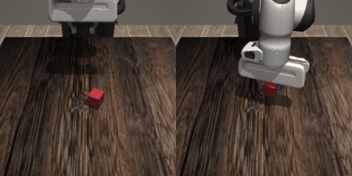
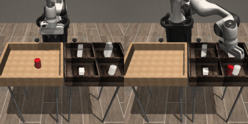
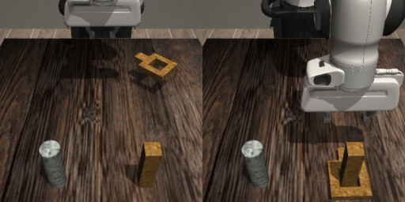
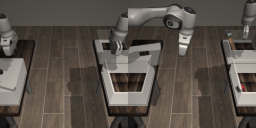
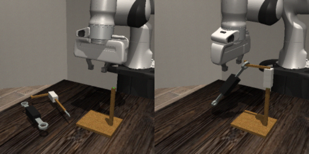

# Tasks

The five robomimic simulation tasks as POMDPs, made with `jax_pomdps.make("robomimic.env:<name>")`. Every task
is robosuite's: its scene, robots, controller, observations, reward, and success check, re-expressed in JAX on
MuJoCo Warp. The quotes are robosuite v1.5's docstrings; the images show the first and last state of each
task's first released demonstration.

Names follow [jax_gym](https://github.com/mishmish66/jax-gym)'s scheme: dashes join words, and slashes add
variants, the reward first and then the observation. Each task `<task>` has a dense reward and `<task>/sparse`
the datasets' sparse reward. Each such `name` observes robomimic's low-dim observations, and also exists as

- `name/prp`, observing each robot's proprioception alone, as one vector;
- `name/pix`, observing images alone: one uint8 image of the cameras of robomimic's image datasets, stacked
  along channels in this order: `agentview` and `robot0_eye_in_hand` at 84×84 for Lift, Can, and Square,
  `shouldercamera0`, `shouldercamera1`, `robot0_eye_in_hand`, and `robot1_eye_in_hand` at 84×84 for Transport,
  and `sideview` and `robot0_eye_in_hand` at 240×240 for Tool Hang; `height` and `width` resize them;
- `name/pix-prp`, observing `{"pixels": ..., "prp": ...}`, those images and the proprioception vector;
- `name/mkv`, observing one vector close enough to the Markov state that a policy of the current observation
  alone can solve the task: the task's object observation of the current state, the proprioception, `qpos`
  and `qvel` of everything but parked objects, each gripper's open / close state, and how far each arm's joints
  are from the positions its controller pulls their nullspace toward (the arm's positions at reset). The next observation, reward,
  and done follow from it and the action; it leaves out only the solver's warm start, as MuJoCo's physics state
  does.

`RobomimicPOMDP(task, observation=..., reward=...)` builds the same POMDPs: `observation` is `"low-dim"`,
`"prp"`, `"mkv"`, or `Pixels(cameras, height, width, proprio)` for any cameras, and `reward` is `"dense"` (the
default) or `"sparse"`.

All tasks share these conventions:

- **Actions** are robosuite's OSC_POSE deltas for each arm, in the world frame, followed by its gripper
  command: 6 values in [-1, 1] scaled to ±5 cm and ±0.5 rad, and one open/close value; Transport has two arms,
  so 14 values.
- **Control** runs at 20 Hz, robosuite's rate for the robomimic datasets: each step is 10 substeps of 5 ms,
  and the OSC controller recomputes the arm torques at every substep.
- **Low-dim observations** are a dictionary keyed like robosuite's: per robot, `robot<i>_joint_pos`, `_joint_pos_cos`,
  `_joint_pos_sin`, `_joint_vel`, `_eef_pos`, `_eef_quat`, `_eef_quat_site`, `_gripper_qpos`, and
  `_gripper_qvel`, and `object`, the task's object observations, in robosuite's order. Quaternions are
  (x, y, z, w).
- **Dense reward** is 1 on success plus each step's change in the task's progress in [0, 1], which counts 1 once
  successful. For each object the task moves, progress is 0.2 for reaching it, 0.2 for gripping it, and 0.6 for
  carrying it to its goal while it is held, in equal stages: lifting it clear, which counts less once it is more
  than 5 cm above its carrying height and nothing 30 cm above that, moving it over the goal, half of it over the
  last 2 cm, which counts only as far as it is lifted, and lowering it in. Gripping is 1 while both finger pads
  hold the object with it between them, and before that half of how far the fingers have closed while the object
  is between them, within 5 cm of the gripper; an object released at its goal, within 25 cm above its placing
  height, counts as held. Every closeness (reaching an object, descending onto it, moving it over its goal, and
  lowering it) counts half over its own scale and half over 1 m, so it pays from anywhere in the workspace.
  Lift, Can, and Square scale progress by how upright the gripper points, as their demonstrations hold it, and
  Transport scales each arm's part from 0.5 to 1 by it. Progress lost is reward lost, so an episode's rewards
  sum to the progress it makes, plus 1 on success.
- **Sparse reward** (`/sparse`) is the datasets' reward: 1 when the task succeeds, 0 otherwise (robosuite's
  normalized sparse reward with `reward_scale` 1).
- **Episodes** end on success (`done`), and, as in MuJoCo Playground, where the simulation diverges to non-finite
  positions or velocities; the dense reward then takes back the progress made, and the sparse reward is 0. There
  is no time limit.
- **Initial states** are drawn from 1024 states sampled from robosuite's reset distribution.

## `lift`

> This class corresponds to the lifting task for a single robot arm.
>
> Sparse un-normalized reward: a discrete reward of 2.25 is provided if the cube is lifted
>
> — robosuite v1.5, `robosuite/environments/manipulation/lift.py`

A Panda arm lifts a cube from a table. **Success**: the cube's center is more than 4 cm above the table top.
**Object observation** (10): the cube's position and quaternion, and its position relative to the gripper.
**Dense reward**: carrying is raising the cube to the success height.

## `can`

> Easier version of task - place one can into its bin.
>
> Sparse un-normalized reward: a discrete reward of 1.0 per object if it is placed in its correct bin
>
> — robosuite v1.5, `robosuite/environments/manipulation/pick_place.py` (`PickPlaceCan`)

A Panda arm moves a can from one bin into its compartment of the other. **Success**: the can is inside its
compartment, below the bin's rim, and the gripper has let go of it. **Object observation** (14): the can's
position and quaternion relative to the gripper, then in the world.
**Dense reward**: carrying is lifting the can 20 cm above the bin floor, moving it over its compartment, and lowering
it in, then moving the gripper 5 cm away from the released can; a can released over its compartment counts as
held.

## `square`

> Easier version of task - place one square nut into its peg.
>
> Sparse un-normalized reward: a discrete reward of 1.0 per nut if it is placed around its correct peg
>
> — robosuite v1.5, `robosuite/environments/manipulation/nut_assembly.py` (`NutAssemblySquare`)

A Panda arm picks up a square nut by its handle and slides it down over a square peg. **Success**: the nut is
within 3 cm of the peg horizontally, low on the peg, and the gripper has let go of it. **Object observation**
(14): the nut's position and quaternion relative to the gripper, then in the world.
**Dense reward**: carrying is lifting the nut 18 cm above the table; moving it over the peg and seating it
(level, and centered and turned so the peg fits through its hole), in equal parts, both counting only as far as
the nut is lifted; lowering it, half to the peg's tip and half down the peg, which the nut can only reach once
the peg passes through its hole; then moving the gripper 5 cm away from the released nut. A nut released over
the peg once the peg fits through it, or on the peg, counts as held.

## `transport`

> This class corresponds to the transport task for two robot arms, requiring a payload to be transported from
> an initial bin into a target bin, while removing trash from the target bin to a trash bin.
>
> Sparse un-normalized reward: a discrete reward of 1.0 is provided when the payload is in the target bin and
> the trash is in the trash bin
>
> — robosuite v1.5, `robosuite/environments/manipulation/two_arm_transport.py`

Two Panda arms facing each other: one lifts a lid and takes a hammer out of its bin and hands it over; the
other clears a piece of trash out of the target bin and places the hammer in it. **Success**: the hammer
touches the target bin's base and the trash touches the trash bin's base. **Object observation** (41): the
poses of the hammer, the trash, and the lid handle, the bin positions, both contact flags, and the objects'
positions relative to the grippers.
**Dense reward**: half for the trash arm, carrying the trash over the trash bin's walls and dropping it in; and
half for the payload arm: 0.3 of it for the lid, slid off the start bin until at most 6 cm of it covers the bin;
and, once the lid is off, 0.7 of it for the payload, carried over the target bin's walls and lowered in, and
handed to the trash arm, which counts for closing in on the payload's handle, linearly over 1 m, and gripping it
until it holds it. Holding and
carrying the payload count as far as the holding gripper's fingers close across its handle, fully within 17 degrees
of square to its long axis and not at all within 46 degrees of it, and as far as the gripper is commanded closed.
Reaching the payload aims at the nearest point along its handle and counts from half, with the fingers along
the handle, to all, with them across it. Either arm counts for reaching and holding, so the payload can pass
between them.

## `tool-hang`

> This class corresponds to the tool hang task for a single robot arm.
>
> Check if tool is hung on frame correctly and frame is assembled coorectly as well.
>
> — robosuite v1.5, `robosuite/environments/manipulation/tool_hang.py`

A Panda arm inserts an L-shaped frame into a stand, then hangs a wrench-like tool on the frame's hook by its
ring. The tightest task: the frame and the ring leave millimeters of clearance. **Success**: the frame stands
upright in the stand's hole, and the tool hangs from the hook without touching the gripper. **Object
observation** (44): the poses of the stand, the frame's hook, and the tool, each relative to the gripper and in
the world, and whether the frame is assembled and the tool is on it.
**Dense reward**: half for the frame: reaching its grip, holding it, turning its post upright, turning it toward its post
upright and turned to fit between the stand's walls as the demonstrations do, counting by the angle of the rotation left, both
coarsely and finely; lifting its tip over the stand's walls as far as the post is upright, bringing it over the slot
between them, half of which counts only as far as it is turned to fit, and lowering it into the slot as far as it is
turned to fit, centering it over the slot to within a centimeter as far as it is turned to fit, and inserting it
down to the slot's floor, linearly from the walls' height, as far as it is so centered,
all counting fully while every arm joint is at least 15 degrees from its limits and not at all with one at a limit; and, once the frame stands, half for the tool: reaching its grip, holding it, and
bringing its hole onto the end of the frame's hook, and centering the hole on the hook to within its
tolerance. Reaching either grip counts from half, with the fingers pointing the opposite way along the axis the
demonstrations close them along, to all, with them pointing as the demonstrations do. A frame released upright
over the slot, or a tool released at the hook's end, counts as held. The gripper may point sideways, as the
demonstrations hold it.

## Training with PPO

Measured in October 2026 with [rlx](https://github.com/mishmish66/rlx)'s PPO on the `/mkv` observation and the
dense reward, from the tasks' own initial states, without demonstrations: one seed each for Lift, Can, and Square,
and about twenty each for Transport and Tool Hang. The setting that trains Lift, Can, and Square: 4096 worlds,
32-step rollouts, discount 0.99, learning rate 3·10⁻⁴ for policy and value, gradient norm clipped at 0.5, 10 epochs
of 32 minibatches, two hidden layers of 64, entropy coefficient 0.01. Success is the share of 10 evaluation
episodes of up to 800 steps that succeed.

| Task | Steps | Success | Best progress |
|---|---|---|---|
| Lift | 14M | 100% | 1 |
| Can | 47M | 100% | 1 |
| Square | 45M | 100% | 1 |
| Transport | 100M | 0% | 0.72 |
| Tool Hang | 100M | 0% | 0.42 |

Lift and Can were measured on these rewards, and Square on its reward before moving over a goal counted half over
its last 2 cm; none of the three has been re-run since episodes began with the grippers' controls matching their
open / close state.

Transport and Tool Hang have not succeeded in any run. Their best runs used 16-step rollouts, a log standard
deviation starting at −1, and entropy coefficients of 0.003 to 0.006, and restarted half of the training episodes
from the highest-progress state each world had reached itself; the restarts are not part of this package. The
Transport and Tool Hang rewards here are newer than those best runs, and their runs so far have done no better.

- **Transport**: arm 1 drops the trash in its bin and arm 0 slides the lid off and grips the payload's handle.
  The payload is never handed to arm 1: arm 0 can carry it only about halfway to the target bin, and arm 1 does
  not come to take it.
- **Tool Hang**: about one seed in nine grips the frame, stands its post upright, turns it to fit between the
  stand's walls, and centers its tip over the slot to within millimeters, then holds it there about 20 cm up
  instead of lowering it in; lowering the arm straight down from those states assembles the frame within 40
  steps. The other seeds stop earlier, gripping the frame and leaving it flat, or turning it upright with a joint
  at its limit, where it cannot be turned to fit. No run has reached the tool.

Starting episodes from the demonstrations' states, from their ends back toward their starts as training goes on,
brings Transport to 0.70 progress in 50M steps, still without success.
