# Tasks

robomimic's five simulation tasks and MimicGen's 26 task variants as POMDPs, made with
`jax_pomdps.make("robomimic.env:<name>")`. Each task's scene, robots, controller, observations, reward, and success
check are robosuite's or MimicGen's, re-expressed in JAX on MuJoCo Warp. The quotes are robosuite v1.5's docstrings;
the images show the first and last state of each task's first released demonstration as the pixels mode renders
them, from the camera of its image datasets.

Names follow [jax_gym](https://github.com/mishmish66/jax-gym)'s scheme: dashes join words, and slashes add
variants, the reward first and then the observation. Each task `<task>` has a dense reward and `<task>/sparse`
the datasets' sparse reward. Each such `name` observes robomimic's low-dim observations, and also exists as

- `name/prp`, observing each robot's proprioception alone, as one vector;
- `name/pix`, observing images alone: one uint8 image of the cameras of robomimic's image datasets, stacked
  along channels in this order: `agentview` and `robot0_eye_in_hand` at 84×84 for Lift, Can, and Square,
  `shouldercamera0`, `shouldercamera1`, `robot0_eye_in_hand`, and `robot1_eye_in_hand` at 84×84 for Transport,
  and `sideview` and `robot0_eye_in_hand` at 240×240 for Tool Hang; `height` and `width` resize them;
- `name/pix-prp`, observing `{"pixels": ..., "prp": ...}`, those images and the proprioception vector;
- `name/mkv`, observing one vector close enough to the Markov state that a policy of the current observation
  alone can solve the task: the task's object observation of the current state, the proprioception, `qpos`
  and `qvel` of everything but parked objects, each gripper's open / close state, and how far each arm's joints
  are from the positions its controller pulls their nullspace toward (the arm's positions at reset). The next observation, reward,
  and done follow from it and the action; it leaves out only the solver's warm start, as MuJoCo's physics state
  does.

The images are this package's own, not robosuite's: MuJoCo Warp's ray tracer renders the scene's lights with
shadows under a dim headlight, at twice the resolution averaged down, and then applies a camera's defocus,
vignetting, warm white balance, and sensor noise seeded from the world's state, so the same state renders the same
image batched or unbatched. Boxes and other primitives show their textures sampled where each ray hits them, the
table top is dark wood, and robosuite's end-effector target markers are not drawn. The images therefore do not match
robomimic's image datasets, which robosuite rendered with OpenGL; depth does. `robomimic.env.render.RENDER_VERSION`
(2) identifies this look, so that images rendered by a different version can be told apart.

`RobomimicPOMDP(task, observation=..., reward=...)` builds the same POMDPs: `observation` is `"low-dim"`,
`"prp"`, `"mkv"`, or `Pixels(cameras, height, width, proprio)` for any cameras, and `reward` is `"dense"` (the
default) or `"sparse"`.

All tasks share these conventions:

- **Actions** are robosuite's OSC_POSE deltas for each arm, in the world frame, followed by its gripper
  command: 6 values in [-1, 1] scaled to ±5 cm and ±0.5 rad, and one open/close value; Transport has two arms,
  so 14 values.
- **Control** runs at 20 Hz, robosuite's rate for the robomimic datasets: each step is 10 substeps of 5 ms,
  and the OSC controller recomputes the arm torques at every substep.
- **Low-dim observations** are a dictionary keyed like robosuite's: per robot, `robot<i>_joint_pos`, `_joint_pos_cos`,
  `_joint_pos_sin`, `_joint_vel`, `_eef_pos`, `_eef_quat`, `_eef_quat_site`, `_gripper_qpos`, and
  `_gripper_qvel`, and `object`, the task's object observations, in robosuite's order. Quaternions are
  (x, y, z, w).
- **Dense reward** is 1 on success plus each step's change in the task's progress in [0, 1], which counts 1 once
  successful. For each object the task moves, progress is 0.2 for reaching it, 0.2 for gripping it, and 0.6 for
  carrying it to its goal while it is held, in equal stages: lifting it clear, which counts less once it is more
  than 5 cm above its carrying height and nothing 30 cm above that, moving it over the goal, half of it over the
  last 2 cm, which counts only as far as it is lifted, and lowering it in. Gripping is 1 while both finger pads
  hold the object with it between them, and before that half of how far the fingers have closed while the object
  is between them, within 5 cm of the gripper; an object released at its goal, within 25 cm above its placing
  height, counts as held. Every closeness (reaching an object, descending onto it, moving it over its goal, and
  lowering it) counts half over its own scale and half over 1 m, so it pays from anywhere in the workspace.
  Lift, Can, and Square scale progress by how upright the gripper points, as their demonstrations hold it, and
  Transport scales each arm's part from 0.5 to 1 by it. Progress lost is reward lost, so an episode's rewards
  sum to the progress it makes, plus 1 on success.
- **Sparse reward** (`/sparse`) is the datasets' reward: 1 when the task succeeds, 0 otherwise (robosuite's
  normalized sparse reward with `reward_scale` 1).
- **Episodes** end on success (`done`), and, as in MuJoCo Playground, where the simulation diverges to non-finite
  positions or velocities; the dense reward then takes back the progress made, and the sparse reward is 0. There
  is no time limit.
- **Initial states** are drawn from 1024 states sampled from robosuite's reset distribution.

## `lift`

> This class corresponds to the lifting task for a single robot arm.
>
> Sparse un-normalized reward: a discrete reward of 2.25 is provided if the cube is lifted
>
> — robosuite v1.5, `robosuite/environments/manipulation/lift.py`

A Panda arm lifts a cube from a table. **Success**: the cube's center is more than 4 cm above the table top.
**Object observation** (10): the cube's position and quaternion, and its position relative to the gripper.
**Dense reward**: carrying is raising the cube to the success height.

## `can`

> Easier version of task - place one can into its bin.
>
> Sparse un-normalized reward: a discrete reward of 1.0 per object if it is placed in its correct bin
>
> — robosuite v1.5, `robosuite/environments/manipulation/pick_place.py` (`PickPlaceCan`)

A Panda arm moves a can from one bin into its compartment of the other. **Success**: the can is inside its
compartment, below the bin's rim, and the gripper has let go of it. **Object observation** (14): the can's
position and quaternion relative to the gripper, then in the world.
**Dense reward**: carrying is lifting the can 20 cm above the bin floor, moving it over its compartment, and lowering
it in, then moving the gripper 5 cm away from the released can; a can released over its compartment counts as
held.

## `square`

> Easier version of task - place one square nut into its peg.
>
> Sparse un-normalized reward: a discrete reward of 1.0 per nut if it is placed around its correct peg
>
> — robosuite v1.5, `robosuite/environments/manipulation/nut_assembly.py` (`NutAssemblySquare`)

A Panda arm picks up a square nut by its handle and slides it down over a square peg. **Success**: the nut is
within 3 cm of the peg horizontally, low on the peg, and the gripper has let go of it. **Object observation**
(14): the nut's position and quaternion relative to the gripper, then in the world.
**Dense reward**: carrying is lifting the nut 18 cm above the table; moving it over the peg and seating it
(level, and centered and turned so the peg fits through its hole), in equal parts, both counting only as far as
the nut is lifted; lowering it, half to the peg's tip and half down the peg, which the nut can only reach once
the peg passes through its hole; then moving the gripper 5 cm away from the released nut. A nut released over
the peg once the peg fits through it, or on the peg, counts as held.

## `transport`

> This class corresponds to the transport task for two robot arms, requiring a payload to be transported from
> an initial bin into a target bin, while removing trash from the target bin to a trash bin.
>
> Sparse un-normalized reward: a discrete reward of 1.0 is provided when the payload is in the target bin and
> the trash is in the trash bin
>
> — robosuite v1.5, `robosuite/environments/manipulation/two_arm_transport.py`

Two Panda arms facing each other: one lifts a lid and takes a hammer out of its bin and hands it over; the
other clears a piece of trash out of the target bin and places the hammer in it. **Success**: the hammer
touches the target bin's base and the trash touches the trash bin's base. **Object observation** (41): the
poses of the hammer, the trash, and the lid handle, the bin positions, both contact flags, and the objects'
positions relative to the grippers.
**Dense reward**: half for the trash arm, carrying the trash over the trash bin's walls and dropping it in; and
half for the payload arm: 0.3 of it for the lid, slid off the start bin until at most 6 cm of it covers the bin;
and, once the lid is off, 0.7 of it for the payload, carried over the target bin's walls and lowered in, and
handed to the trash arm, which counts for closing in on the payload's handle, linearly over 1 m, and gripping it
until it holds it. Holding and
carrying the payload count as far as the holding gripper's fingers close across its handle, fully within 17 degrees
of square to its long axis and not at all within 46 degrees of it, and as far as the gripper is commanded closed.
Reaching the payload aims at the nearest point along its handle and counts from half, with the fingers along
the handle, to all, with them across it. Either arm counts for reaching and holding, so the payload can pass
between them.

## `tool-hang`

> This class corresponds to the tool hang task for a single robot arm.
>
> Check if tool is hung on frame correctly and frame is assembled coorectly as well.
>
> — robosuite v1.5, `robosuite/environments/manipulation/tool_hang.py`

A Panda arm inserts an L-shaped frame into a stand, then hangs a wrench-like tool on the frame's hook by its
ring. The tightest task: the frame and the ring leave millimeters of clearance. **Success**: the frame stands
upright in the stand's hole, and the tool hangs from the hook without touching the gripper. **Object
observation** (44): the poses of the stand, the frame's hook, and the tool, each relative to the gripper and in
the world, and whether the frame is assembled and the tool is on it.
**Dense reward**: half for the frame: reaching its grip, holding it, turning its post upright, turning it toward its post
upright and turned to fit between the stand's walls as the demonstrations do, counting by the angle of the rotation left, both
coarsely and finely; lifting its tip over the stand's walls as far as the post is upright, bringing it over the slot
between them, half of which counts only as far as it is turned to fit, and lowering it into the slot as far as it is
turned to fit, centering it over the slot to within a centimeter as far as it is turned to fit, and inserting it
down to the slot's floor, linearly from the walls' height, as far as it is so centered,
all counting fully while every arm joint is at least 15 degrees from its limits and not at all with one at a limit; and, once the frame stands, half for the tool: reaching its grip, holding it, and
bringing its hole onto the end of the frame's hook, and centering the hole on the hook to within its
tolerance. Reaching either grip counts from half, with the fingers pointing the opposite way along the axis the
demonstrations close them along, to all, with them pointing as the demonstrations do. A frame released upright
over the slot, or a tool released at the hook's end, counts as held. The gripper may point sideways, as the
demonstrations hold it.

## MimicGen tasks

The tasks of [MimicGen](https://github.com/NVlabs/mimicgen) are made the same way, one for each of its initial-state
distributions (D0, D1, D2): `stack-d0`, `stack-d1`, `stack-three-d0`, `stack-three-d1`, `square-d0`, `square-d1`,
`square-d2`, `threading-d0`, `threading-d1`, `threading-d2`, `coffee-d0`, `coffee-d1`, `coffee-d2`,
`three-piece-assembly-d0`, `three-piece-assembly-d1`, `three-piece-assembly-d2`, `hammer-cleanup-d0`,
`hammer-cleanup-d1`, `mug-cleanup-d0`, `mug-cleanup-d1`, `kitchen-d0`, `kitchen-d1`, `nut-assembly-d0`,
`pick-place-d0`, `coffee-preparation-d0`, and `coffee-preparation-d1`. Their `/pix` variants observe `agentview` and
`robot0_eye_in_hand` at 84×84, the cameras of MimicGen's datasets. MimicGen recorded all of them on robosuite v1.4
(the commit its installation guide pins), and they follow that version where it differs from v1.5:

- **Gripper**: the open / close state moves 0.01 in each of a step's 25 substeps, rather than 0.2 once per step.
- **Proprioception**: `robot<i>_eef_vel_lin` and `_eef_vel_ang`, the linear and angular velocity of the hand body,
  in place of `_eef_quat_site`.
- **Object poses relative to the gripper** are those of the current state, as MimicGen's datasets record them, with
  the gripper's position from its grip site and its orientation from its hand body. Each object's block of the
  object observation is its position, quaternion, and pose relative to the gripper, in that order.
- **Dense reward**: Square, NutAssembly, and PickPlace use the stages of `square` and `can`; the other tasks have no
  robosuite progress conventions upstream, so each defines its own stages below.

They also differ from the robomimic tasks in these ways:

- **Robot**: NutAssembly D0 and PickPlace D0 use a Sawyer arm with the Rethink gripper; all other MimicGen tasks use a
  Panda arm. The sparse rewards of these two in MimicGen's datasets are fractional, the share of objects placed (0.5 per
  nut, 0.25 per object), and `/sparse` reproduces them; `success` is all objects placed.
- **Models**: some variants change the model between resets in MimicGen: Square D1 and D2 the peg's pose, MugCleanup D1
  the drawer's pose, Kitchen D1 the poses of the stove, the button, and the serving region, HammerCleanup D1 the
  cabinet's pose, and HammerCleanup the hammer's size, mass, and handle friction. Each reset of the POMDP sets the
  fixture poses recorded with its initial state, per world; the `/mkv` observation includes them. The hammer is the
  one of the task's own model in every reset. A dataset demo is simulated in its own `model_file` (`model_xml`).
- **Memory**: Kitchen's success needs a flag that robosuite keeps outside the simulator state: whether the stove has
  been on with the pot on the burner and the bread in the pot. The POMDP keeps it as the task's memory in the state,
  and the `/mkv` observation includes it.
- **Force observations**: HammerCleanup and Kitchen have the extra low-dim keys `robot0_eef_force_norm`, the norm of the
  gripper's force sensor, and `robot0_contact`, whether that norm is above 2 N. robosuite subtracts a bias it sets at
  the first step of a live episode; in the datasets the bias is 0, and the POMDP uses none.

### `stack-d0`, `stack-d1`

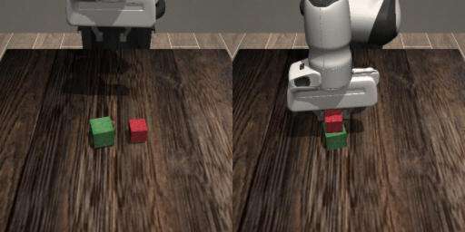

A Panda arm stacks a red cube on a green one, both placed at random on the table, at any yaw, within 8 cm of its
center in D0 and 20 cm in D1. **Success**: the red cube is not grasped, its center is more than 4 cm above the table,
and it touches the green cube. **Object observation** (23): each cube's position and quaternion, each cube's position
relative to the gripper, and the green cube's position relative to the red one. **Dense reward**: reaching and holding
the red cube, lifting it over the green cube, and lowering it onto it; a red cube released resting on the green one
counts as held. **Shaped reward**: robosuite's staged reward, halved.

### `stack-three-d0`, `stack-three-d1`

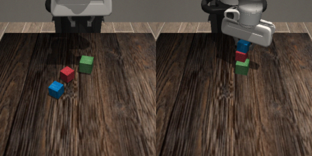

A Panda arm stacks cube A (4 cm) on cube B (5 cm), then cube C (4 cm) on cube A. The three cubes are placed at random
on the table, at any yaw, within 10 cm of its center in D0 and 20 cm in D1. **Success**: neither cube A nor cube C is
grasped, A's center is more than 4 cm above the table and A touches B, and C's center is more than 8 cm above the table
and C touches A. **Object observation** (39): Stack's 23 entries, then cube C's position and quaternion, its position
relative to the gripper and to cube A, and cube B's position relative to cube C. **Dense reward**: half for stacking
cube A on cube B, as in `stack-d0`; half, once A is released on B, for stacking cube C on A.

### `square-d0`, `square-d1`, `square-d2`

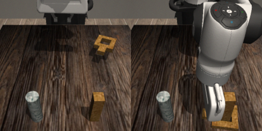

`square` at MimicGen's initial states: a Panda arm slides the square nut down over the square peg. In D0 the nut and
peg start as in `square`. In D1 the peg stands at random in a 40 cm square and the round peg is removed; the nut starts
at random in a 23 × 51 cm region, at any yaw, more than 13 cm from the peg. In D2, also without the round peg, the nut
and the peg each start at random within 25 cm of the table's center in x and y, the peg at a yaw in [0°, 90°]. **Success**: as in `square`.
**Object observation**: 14 in D0, the nut's position, quaternion, and pose relative to the gripper; 17 in D1 and D2,
which add the peg's position. **Dense reward**: as in `square`. **Shaped reward**: robosuite's staged reward.

### `threading-d0`, `threading-d1`, `threading-d2`

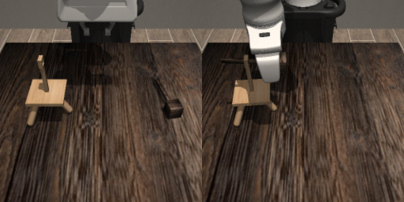

A Panda arm threads a needle through the ring of a tripod. In D0 the needle lies at random in a 15 × 10 cm region,
at a yaw in [−120°, −60°], and the tripod stands at a fixed pose. In D1 the needle lies in a 25 × 10 cm region at a
yaw over a 240° range, and the tripod stands at random in a 25 × 10 cm region on the robot's right, at a yaw over a
120° range. D2 is D1 with the needle on the robot's right and the tripod on its left, at a yaw in [−150°, −30°].
**Success**: the center of the needle's bar is within 12 mm of the ring's center. **Object observation** (28): for the needle and the tripod, the
position, quaternion, and pose relative to the gripper. **Dense reward**: reaching the needle's handle, holding the
needle, and bringing its bar's center to the ring's.

### `coffee-d0`, `coffee-d1`, `coffee-d2`

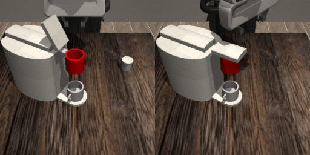

A Panda arm puts a coffee pod into a coffee machine's pod holder and closes the machine's lid; the lid starts open. In
D0 the machine stands at a fixed pose and the pod starts at random within a 6 cm square. In D1 the machine stands at
random in a 10 cm square on the robot's right, at a yaw in [−30°, 60°], and the pod starts in a 25 × 13 cm region on
its left. D2 places the machine in a 10 cm square on the robot's left, at a yaw in [120°, 210°], and the pod in a
25 × 13 cm region on its right. **Success**: the lid is within 15 degrees of closed, and the pod is within 5.2 mm of the
holder's axis, above the holder's floor, and below the lid. **Object observation** (57): for the pod, the machine, the
pod holder, and the lid, the position, quaternion, and pose relative to the gripper, then the lid's hinge angle; the
low-dim observation also holds the grip site's pose relative to the pod and to the pod holder
(`robot0_eef_pos_rel_pod`, `_quat_rel_pod`, `_pos_rel_pod_holder`, `_quat_rel_pod_holder`). **Dense reward**: half for
the pod, reaching it, holding it, lifting it over the holder, and lowering it in, a pod released in the holder counting
as held; half for closing the lid once the pod is in.

### `three-piece-assembly-d0`, `three-piece-assembly-d1`, `three-piece-assembly-d2`

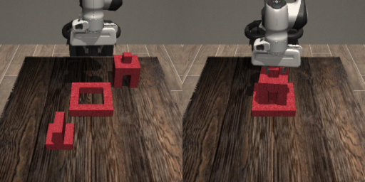

A Panda arm drops piece 1, a square slab with a ridge on top, into the square hole of a base frame, then sets piece 2,
which has a slot between two legs, over piece 1's ridge. In D0 the base lies at the table's center and the two pieces
at random within 22 cm of it in x and y, clear of the base and of each other, turned to fit. In D1 the base also lies
at random within 22 cm of the center. In D2 the base is also turned by up to 45 degrees and each piece by up to 90
degrees from its D1 yaw, so the pieces must be turned to fit. **Success**: piece 1 is within 2 cm of the base's center horizontally and not grasped, and piece 2
is within 2 cm of piece 1 horizontally, its center within 2 cm of 8 cm above the base's, and not grasped. **Object
observation** (42): for the base, piece 1, and piece 2, the position, quaternion, and pose relative to the gripper; the
low-dim observation also holds the grip site's pose relative to each (`robot0_eef_pos_rel_base`, `_quat_rel_base`,
`_pos_rel_piece_1`, `_quat_rel_piece_1`, `_pos_rel_piece_2`, `_quat_rel_piece_2`). **Dense reward**: half for piece 1:
reaching its ridge, holding it, lifting it over the base, moving it over the hole and fitting it (level, and centered and
turned so it passes through the hole), in equal parts, both counting only as far as it is lifted, and lowering it in;
half, once piece 1 rests in the base, for piece 2, carried the same way onto piece 1's ridge. A piece released within
3 cm of its goal horizontally, resting there or falling into it from within 5 cm while it fits, counts as held.

### `hammer-cleanup-d0`, `hammer-cleanup-d1`

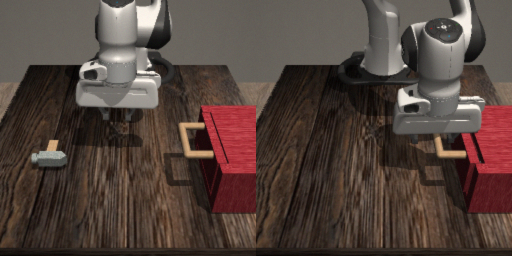

A Panda arm pulls a drawer open, puts a hammer into it, and pushes the drawer closed. In D0 the drawer's cabinet stands
at a fixed pose and the hammer lies at random in an 8 × 7 cm region, its handle along the x axis. In D1 the cabinet
stands at random in a 20 × 10 cm region, at a yaw in [−30°, 30°], and the hammer lies in a 40 × 12 cm
region, its handle pointing in any direction. **Success**: the drawer is within 1 cm of closed and the hammer is in it:
in D0, the hammer's center is between 0.94 and 1.0 m high and its y coordinate is above 0.22 m; in D1, the hammer touches the
drawer's bottom. **Object observation** (28): for the hammer and the cabinet, the position, quaternion, and pose
relative to the gripper; the low-dim observation also holds `robot0_eef_force_norm` and `robot0_contact`. **Dense
reward**: a third each for pulling the drawer open, reaching its handle and opening it 10 cm; for the hammer, once the
drawer is open more than 5 cm, reaching it, holding it, and carrying it onto the drawer's bottom, a hammer released
within 15 cm above the bottom counting as held; and for reaching the handle and pushing the drawer closed.

### `mug-cleanup-d0`, `mug-cleanup-d1`

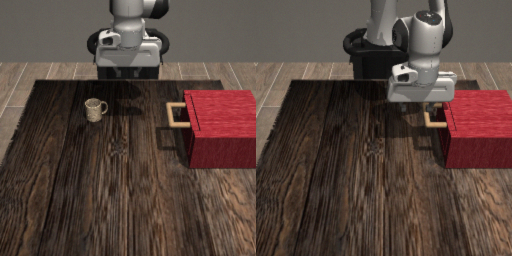

A Panda arm pulls a drawer open, puts a mug upright into it, and pushes the drawer closed. In D0 the drawer's cabinet
stands at a fixed pose and the mug at random in a 30 × 15 cm region, at any yaw. In D1 the cabinet stands at random in
a 20 × 10 cm region, at a yaw in [−30°, 30°], and the mug in a 40 × 15 cm region. **Success**: the drawer is
within 1 cm of closed, the mug is within 2.6 degrees of upright, and it touches the drawer's bottom. **Object
observation** (29): for the mug and the cabinet, the position, quaternion, and pose relative to the gripper, then the
drawer's slide position. **Dense reward**: a quarter for reaching the drawer's handle and pulling the drawer 13 cm
open; half for the mug, reaching it, holding it, lifting it over the open drawer, and lowering it onto the drawer's
bottom, the carrying counting as far as the drawer is open, a mug released within 26 degrees of upright over the
bottom, within 3 cm above resting, counting as held; a quarter, once the mug is in, for reaching the handle and pushing the drawer closed.

### `kitchen-d0`, `kitchen-d1`

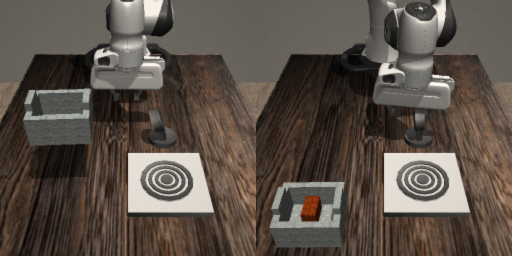

A Panda arm turns on a stove by its button, puts a pot on the stove and a piece of bread in the pot, moves the pot into
a serving region, and turns the stove off. In D0 the stove, the button, and the serving region are at fixed poses; the
bread starts at random in a 3 × 6 cm region and the pot in a 0.5 × 2 cm region, dropped from 14 cm above its resting
height, and the button's hinge starts at −0.4 rad, beyond its range of ±0.3 rad. In D1 the stove, the button, and the
serving region stand at random in regions of up to 26 × 15 cm, the bread in a 20 × 20 cm region at a yaw in
[−90°, 90°], the pot in a 10 × 15 cm region at a yaw in [−30°, 30°], and the button at −0.3 rad. **Success**: the
stove is off, the bread touches the pot, the pot is within 5 cm in x, 10 cm in y, and 5 cm in height of the serving
region's center, and the stove has been on with the pot on the burner and the bread touching the pot. The stove is on
while the button's hinge is at 0 or above. **Object observation**: 56 in D0, for the stove, the bread, the pot, and
the serving region, the position, quaternion, and pose relative to the gripper; 70 in D1, which adds the button's. The
low-dim observation also holds `robot0_eef_force_norm` and `robot0_contact`. **Dense reward**: a fifth for each stage, in
the demonstrations' order: reaching the button and turning the stove on; reaching, holding, and carrying the pot onto
the stove; reaching, holding, and carrying the bread into the pot; carrying or pushing the pot into the serving region
with the bread in it; and reaching the button and turning the stove off. The first three count as done once the stove
has been on with the pot on it and the bread in the pot; a pot released over the stove, or bread released in the pot,
counts as held.

### `nut-assembly-d0`

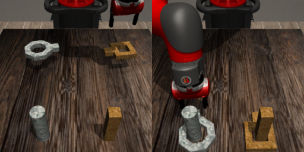

A Sawyer arm puts the square nut on the square peg and the round nut on the round peg, the nuts starting as in
robosuite's NutAssembly. **Success**: each nut is within 3 cm of its peg horizontally, low on the peg, and the gripper
has let go of it. **Sparse reward**: 0.5 per placed nut. **Object observation** (28): for each nut, the position,
quaternion, and pose relative to the gripper. **Dense reward**: the mean over the nuts of each one's progress as in `square`
(the round nut needing no fit through its hole), without the gripper's uprightness, counting only the nuts released at
their pegs and the one other nut furthest along, that one scaled by how upright the gripper points. **Shaped reward**: robosuite's staged reward, scaled
like the sparse reward.

### `pick-place-d0`

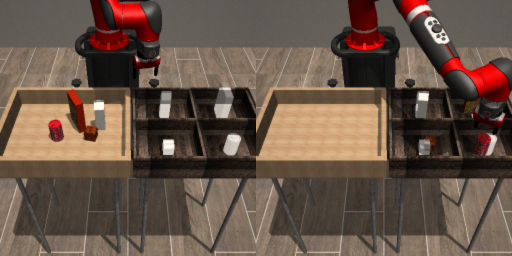

A Sawyer arm moves a milk carton, a loaf of bread, a cereal box, and a can from one bin into their compartments of the
other, the objects starting at random in the first bin at yaws in [0°, 90°]. **Success**: each object is inside its
compartment, below the bin's rim, and the gripper has let go of it. **Sparse reward**: 0.25 per placed object.
**Object observation** (56): for the milk, the bread, the cereal, and the can, the position, quaternion, and pose
relative to the gripper. **Dense reward**: the mean over the objects of each one's progress as in `can`, lowered to its
own resting height, without the gripper's uprightness, counting only the objects released over their compartments,
standing or not, and the one other object furthest along, that one scaled by how upright the gripper points. **Shaped reward**: robosuite's staged reward,
scaled like the sparse reward.

### `coffee-preparation-d0`, `coffee-preparation-d1`

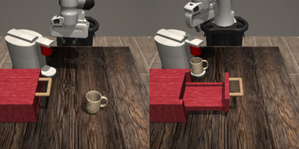

A Panda arm sets a mug upright on the coffee machine's base plate, opens the machine's lid, pulls a drawer open, takes
the pod from the drawer, puts it into the pod holder, and closes the lid. The lid and the drawer start closed, and the
pod lies at random in a 6 × 8 cm region of the drawer. In D0 the machine and the drawer's cabinet stand at fixed poses,
and the mug at random in a 15 × 20 cm region, upright at a fixed yaw. In D1 the machine stands at random in a
10 × 5 cm region, at a yaw in [−30°, 30°], and the mug in a 35 × 20 cm region at any yaw. **Success**: as in
`coffee-d0`, and the mug is within 2.6 degrees of upright and touches the base plate. **Object observation** (86): for
the pod, the machine, the pod holder, the lid, the cabinet, and the mug, the position, quaternion, and pose relative to
the gripper, then the lid's hinge angle and the drawer's slide position; the low-dim observation also holds Coffee's
`robot0_eef_pos_rel_pod`, `_quat_rel_pod`, `_pos_rel_pod_holder`, and `_quat_rel_pod_holder`. **Dense reward**, in the
demonstrations' order, each stage's reaching counting once the stages before it are done: 0.25 for reaching the mug's
rim, holding the mug, and carrying it onto the base plate under the holder; 0.1 for reaching the lid and opening it to
1.5 rad; 0.1 for reaching the drawer's handle and pulling the drawer 19 cm open; 0.35 for the pod, as in `coffee-d0`;
and 0.2 for closing the lid once the pod is in the holder. Opening the lid and the drawer count as done once the pod is
held or in the holder.

## Training with PPO

Measured in October 2026 with [rlx](https://github.com/mishmish66/rlx)'s PPO on the `/mkv` observation and the
dense reward, from the tasks' own initial states, without demonstrations: one seed each for Lift, Can, and Square,
and about twenty each for Transport and Tool Hang. The setting that trains Lift, Can, and Square: 4096 worlds,
32-step rollouts, discount 0.99, learning rate 3·10⁻⁴ for policy and value, gradient norm clipped at 0.5, 10 epochs
of 32 minibatches, two hidden layers of 64, entropy coefficient 0.01. Success is the share of 10 evaluation
episodes of up to 800 steps that succeed.

| Task | Steps | Success | Best progress |
|---|---|---|---|
| Lift | 14M | 100% | 1 |
| Can | 47M | 100% | 1 |
| Square | 45M | 100% | 1 |
| Transport | 100M | 0% | 0.72 |
| Tool Hang | 100M | 0% | 0.42 |

Lift and Can were measured on these rewards, and Square on its reward before moving over a goal counted half over
its last 2 cm; none of the three has been re-run since episodes began with the grippers' controls matching their
open / close state.

Transport and Tool Hang have not succeeded in any run. Their best runs used 16-step rollouts, a log standard
deviation starting at −1, and entropy coefficients of 0.003 to 0.006, and restarted half of the training episodes
from the highest-progress state each world had reached itself; the restarts are not part of this package. The
Transport and Tool Hang rewards here are newer than those best runs, and their runs so far have done no better.

- **Transport**: arm 1 drops the trash in its bin and arm 0 slides the lid off and grips the payload's handle.
  The payload is never handed to arm 1: arm 0 can carry it only about halfway to the target bin, and arm 1 does
  not come to take it.
- **Tool Hang**: about one seed in nine grips the frame, stands its post upright, turns it to fit between the
  stand's walls, and centers its tip over the slot to within millimeters, then holds it there about 20 cm up
  instead of lowering it in; lowering the arm straight down from those states assembles the frame within 40
  steps. The other seeds stop earlier, gripping the frame and leaving it flat, or turning it upright with a joint
  at its limit, where it cannot be turned to fit. No run has reached the tool.

Starting episodes from the demonstrations' states, from their ends back toward their starts as training goes on,
brings Transport to 0.70 progress in 50M steps, still without success.
